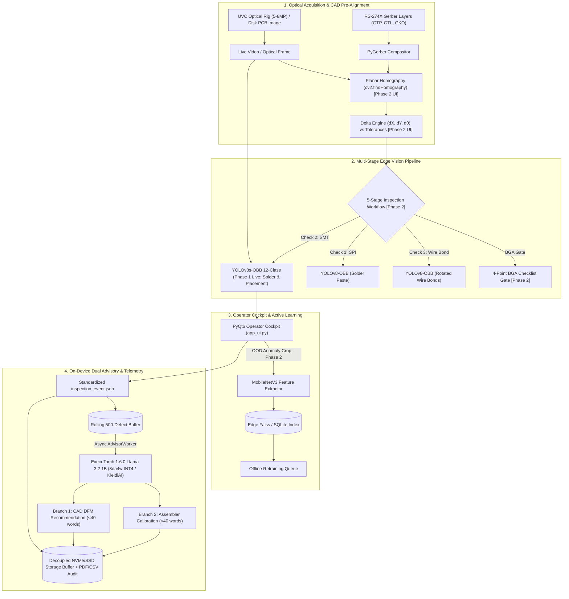

# Closed-Loop Multi-Tier Edge AOI & Quality-Control Copilot

[](#)
[](#)
[](#)
[](#)

> **Research Lab:** IC~WiBES, Center for VLSI and Embedded System Technologies (CVEST), IIIT Hyderabad  
> **Faculty Advisor:** Dr. Abhishek Srivastava  
> **Target Hardware:** AMD Xilinx ZCU104 Evaluation Kit (Zynq UltraScale+ XCZU7EV MPSoC) *(with Raspberry Pi 5 / Arm Cortex-A53 fallback)*

---

## 1. Executive Overview & Problem Differentiation

Mid-scale Indian Electronics Manufacturing Services (EMS), Advanced Packaging, and Original Design Manufacturer (ODM) shops assemble high-density Printed Circuit Boards (PCBs) and System-in-Package (SiP) modules featuring 0.65 mm pitch BGAs, 0201 discrete passives, fine-pitch QFPs, and sub-millimeter micro-electronic wire bonds. Standard industrial Automated Optical Inspection (AOI) units carry prohibitive capital expenditures (₹15–50+ Lakh) and operate as rigid, passive "pass/fail" filters without intelligent closed-loop diagnostic feedback.

Our architecture introduces **four fundamental differentiators**:
1. **Multi-Scale Oriented Micro-Defect Detection (YOLOv8s-OBB):** Predicts rotated bounding boxes `(xc, yc, w, h, θ)` across 12 SMT solder, placement, and assembly defect classes (**0.893 mAP@0.5** in Phase 1), extending in Phase 2 to high-aspect-ratio wire bonds (wire sweep, sagging, lifted heels, neck cracks) and SPI paste where horizontal boxes fail.
2. **Dual Closed-Loop Root-Cause Advisory (ExecuTorch 1.6.0 Llama 3.2 1B):** Evaluates the active inspection event and a rolling 500-defect memory buffer to generate `<40 word` actionable root causes tailored separately for:
   - **The CAD/Layout Designer (DFM):** Highlights layout traps, pad clearance bottlenecks, and thermal relief issues to fix future board spins.
   - **The SMT/Wire Bonding Assembler:** Recommends physical machine adjustments (reflow profile, stencil/paste pressure, nozzle vacuum/alignment, capillary ultrasonic power, bonding force) to prevent scrap in the current production run.
3. **Decoupled Edge Compute & Bulk Storage:** Real-time inference (YOLOv8-OBB on FPGA DPU / Arm CPU) and low-latency LLM advisory execute strictly at the edge with zero cloud dependency. A decoupled local storage buffer isolates multi-megapixel RAW defect image bursts, feature embeddings, and JSONL telemetry logs, preventing DRAM bandwidth choking during real-time inspection.
4. **Operator-in-the-Loop Anomaly Ingestion (Active Learning):** Out-of-distribution (OOD) defects identified on the shop floor can be cropped and tagged by the AOI operator (`operator_ingest_tool.py`). A lightweight MobileNetV3 feature extractor (`embedding_extractor.py`) indexes the anomaly into a local edge vector store for zero-downtime few-shot recognition and queues the sample for offline incremental retraining *(planned for Phase 2 UI integration)*.

---

## 2. Full Target System Architecture



---

## 3. Team Role Split & Ownership Matrix

| Role & Owner | Primary Domain | Owned Subsystems & Deliverables | Key Frameworks |
| :--- | :--- | :--- | :--- |
| **Member 1: Vision AI & Dataset Lead** | Vision Models, OBB Datasets & Ingestion | • Curate & merge public SMT/wire bonding datasets (`build_smt_merged.py`, `convert_soldef.py`)<br>• Train 12-class YOLOv8s-OBB (`train_obb.py`, `infer_vision.py`) & export `.pte`<br>• Expand to wire-bond & SPI paste classes *(Phase 2)*<br>• MobileNetV3 embedding extractor (`embedding_extractor.py`) | PyTorch, Ultralytics YOLOv8-OBB, OpenCV, ExecuTorch |
| **Member 2: Edge SoC, ExecuTorch & FPGA Lead** | Embedded Linux, LLM Advisory & HW-SW Co-Design | • Quantize & run Llama 3.2 1B via ExecuTorch 1.6.0 `8da4w` INT4 (`export_llama_pte.py`)<br>• Dual-feedback prompt engine (`dual_advisor.py` + GGUF fallback)<br>• High-speed storage manager (`storage_manager.py`)<br>• Bring up Ubuntu/PetaLinux on ZCU104 PS, KleidiAI & Vitis AI DPU compilation *(Phase 2/3)* | Meta ExecuTorch 1.6.0, `optimum-executorch`, Arm KleidiAI, AMD Vitis AI, XNNPACK |
| **Member 3: Gerber Homography, UI & Integration Lead** | CAD Alignment, Operator UI & System Loop | • Minimal responsive PyQt6 Operator Cockpit (`app_ui.py`) & PDF/CSV reports (`report_generator.py`)<br>• RS-274X Gerber parser (`gerber_renderer.py`) & fiducial homography (`homography_align.py`) *(Phase 2 UI)*<br>• 1-Click anomaly ingestion tool (`operator_ingest_tool.py`) & 5-stage BGA gate *(Phase 2 UI)* | Python, PyQt6, PyGerber, OpenCV, ReportLab |

---

## 4. Repository Layout

```text
bharat-ai-soc-ps5-pcb-aoi/
├── README.md                              # Master architecture, Phase 1 baseline, roadmap & credits
├── AGENTS.md                              # Multi-developer collaboration protocol & schema lock
├── requirements.txt                       # Core Python dependencies
├── .github/workflows/ci.yml               # CI workflow running pytest
├── configs/
│   ├── tolerances.yaml                    # Standard, Fine-pitch, BGA, and Wire Bond thresholds
│   └── prompts.yaml                       # DFM Designer and Assembler Calibration prompt templates
├── data/
│   └── practical_test_samples/            # Real populated PCB defect images (01–05) + README.md
├── docs/
│   └── TIER0_BASELINE_MIGRATION_GUIDE.md  # Tier-0 PC to ZCU104 / Arm SoC migration reference
├── module_a_vision/                       # Member 1: YOLOv8s-OBB inference, weights & embeddings
│   ├── README.md                          # Dataset fusion, class taxonomy, training & eval results
│   ├── download_weights.py                # Downloads published YOLOv8-OBB weights
│   ├── embedding_extractor.py             # MobileNetV3 feature extractor (Phase 2 active learning)
│   └── infer_vision.py                    # VisionInferenceEngine emitting schema-compliant defects
├── module_b_guidance/                     # Member 3: Operator UI, Gerber parser & audit reports
│   ├── app_ui.py                          # Minimal responsive PyQt6 Operator Cockpit (Phase 1)
│   ├── gerber_renderer.py                 # PyGerber RS-274X Gerber layer parser
│   ├── homography_align.py                # Fiducial homography & dX/dY/dTheta (Phase 2 UI)
│   ├── operator_ingest_tool.py            # OOD anomaly crop & ingest dialog (Phase 2 UI)
│   ├── report_generator.py                # One-click PDF & CSV inspection report exporter
│   └── requirements.txt                   # Module B / UI-specific dependencies
├── edge_llm_storage/                      # Member 2: ExecuTorch Llama 3.2 1B & storage buffering
│   ├── dual_advisor.py                    # ExecuTorch 1.6.0 TextLLMRunner + GGUF fallback
│   ├── export_llama_pte.py                # optimum-executorch XNNPACK 8da4w INT4 export script
│   └── storage_manager.py                 # JSONL telemetry & raw defect crop logger
├── schemas/
│   ├── inspection_event.json              # Shared JSON Schema contract
│   └── sample_inspection_event.json       # Standard verification payload
├── tests/
│   ├── test_contract.py                   # Contract schema & end-to-end validation
│   ├── test_module_b_guidance.py          # UI, Gerber, homography, ingest & PDF/CSV tests
│   └── test_vision_inference.py           # Vision inference & class mapping tests
└── tools/
    ├── stream_camera_windows.py           # Low-latency Windows-to-WSL2 HTTP camera bridge
    └── test_e2e_pipeline.py               # Headless CLI end-to-end pipeline verification
```

---

## 5. Master Evaluation Targets & Verified Phase 1 Baseline

| Tier | Compute Placement | Precision | Vision Latency | LLM Gen Speed / Time | Peak RAM | Accuracy / Status |
| :--- | :--- | :--- | :--- | :--- | :--- | :--- |
| **Tier 0 (Verified Phase 1)** | Workstation PC (`x86_64`) | FP32 Vision + INT4 LLM (`8da4w`) | **~228 ms** warm (CPU) | **6.2–7.2 tok/s** decode · **150–180 tok/s** prefill | **1.33–1.76 GiB** | **0.893 mAP@0.5** (12/12 tests pass) |
| **Tier 1 (Target)** | ZCU104 Cortex-A53 (PS only) | FP32 | `< 3000 ms` | `< 10 s` | `< 1800 MB` | `≥ 85% mAP@0.5` |
| **Tier 2 (Target)** | ZCU104 Cortex-A53 (KleidiAI) | INT8 PTQ | `< 1500 ms` | `< 6 s` | `< 1200 MB` | `≥ 85% mAP@0.5` |
| **Tier 3 (Target)** | Vision DPU (PL) + LLM (PS) | INT8 + INT4 | `< 400 ms` | `< 3 s` | `< 1100 MB` | `≥ 85% mAP@0.5` |

---

## 6. Quickstart

### 1. Environment Setup
```bash
git clone https://github.com/MadhanSaiKrishna/bharat-ai-soc-ps5-pcb-aoi.git
cd bharat-ai-soc-ps5-pcb-aoi
python3 -m venv venv
source venv/bin/activate
pip install -r requirements.txt
```

### 2. Model Weights Setup (`v1.0.0-phase1` Release)
Download the pre-exported weights from the [`v1.0.0-phase1`](https://github.com/MadhanSaiKrishna/bharat-ai-soc-ps5-pcb-aoi/releases/tag/v1.0.0-phase1) GitHub Release:
- Place `model.pte` (915 MB) and `tokenizer.model` (2.1 MB) into `edge_llm_storage/weights/`
- Place `smt_merged_v2_v8s.pt` (23 MB) and `smt_merged_v2_v8s_xnnpack.pte` (44 MB) into `module_a_vision/weights/` *(or run `python3 -m module_a_vision.download_weights`)*

### 3. Run Verification & Operator Cockpit
```bash
# Run full test suite (12 tests: contract, vision, UI & report export)
python3 -m pytest tests/

# Verify dual LLM advisor standalone
python3 edge_llm_storage/dual_advisor.py --mock-input schemas/sample_inspection_event.json

# Launch the interactive Operator Cockpit UI
python3 module_b_guidance/app_ui.py
```

---

## 7. Phase 2 & Phase 3 Roadmap and Porting Tradeoffs

- **Phase 2 (CAD Alignment, 5-Stage Gate & Active Learning):**
  - Surface live RS-274X Gerber CAD overlay (0–100% opacity), fiducial homography (`ΔX/ΔY/Δθ` tolerance gating via `homography_align.py`), and 5-stage / 4-point BGA checklist once paired with a fixed-mount `See3CAM_CU30` optical rig.
  - Enable 1-click OOD anomaly cropping (`operator_ingest_tool.py`) + MobileNetV3 edge vector store (`embedding_extractor.py`) for few-shot recognition and offline incremental retraining.
  - Expand vision dataset (`vision-v3`) with wire-bond (wire sweep, lifted heel, loop sag), SPI paste, and macro See3CAM calibration shots.
- **Phase 3 (Target Arm SoC & FPGA DPU Deployment):**
  - **Vision DPU Tradeoff:** Compile YOLOv8s-OBB backbone to INT8 `.xmodel` on the ZCU104 Vitis AI DPU (`< 400 ms`), while keeping rotated-box (`OBB` angle) decoding and NMS on Arm PS CPU to avoid custom DPU op failures.
  - **LLM PS RAM Tradeoff:** Retain `8da4w` INT4 + `max_seq_len=512` + `< 40 words` output cap to stay within ZCU104's `< 1.8 GB` PS DRAM budget, using Arm KleidiAI kernels and async `AdvisorWorker` execution.

---

## 8. Model, Dataset & Tooling Credits

- **Meta Llama 3.2 1B-Instruct** (`unsloth/Llama-3.2-1B-Instruct`, `bartowski/Llama-3.2-1B-Instruct-GGUF`) — Meta Llama 3.2 Community License; Dubey et al., *"The Llama 3 Herd of Models"*, arXiv:2407.21783 (2024).
- **Meta ExecuTorch 1.6.0 & `optimum-executorch`** (XNNPACK `8da4w` INT4 quantization) + **Arm KleidiAI**.
- **Ultralytics YOLOv8s-OBB** (AGPL-3.0) — fine-tuned via `module_a_vision/train_obb.py`.
- **Datasets:** [`ParsaVictor/pcb-solder-defect-detection`](https://huggingface.co/datasets/ParsaVictor/pcb-solder-defect-detection) (Hugging Face, 5,209 images), [`SolDef_AI`](https://www.kaggle.com/datasets/mauriziocalabrese/soldef-ai-pcb-dataset-for-defect-detection) (Kaggle, GPL-3.0, 200 joint-level macro images), and [`SMD Component Placement Defect 2`](https://universe.roboflow.com/muhammad-huda-ferdinansyah/smd-component-placement-defect-2) (Roboflow Universe, CC BY 4.0, 2,750 originals). Full details in [`module_a_vision/README.md`](module_a_vision/README.md).
- **Libraries & Hardware:** PyGerber, PyQt6, OpenCV, Pillow, ReportLab, AMD Xilinx ZCU104 MPSoC, and e-con Systems See3CAM_CU30.
