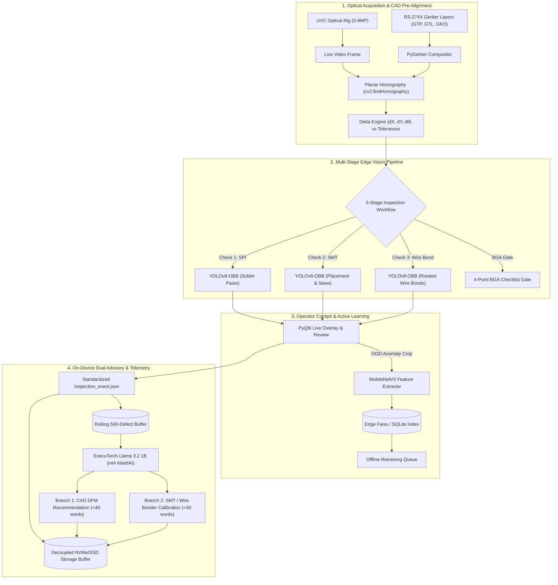

# Closed-Loop Multi-Tier Edge AOI & Quality-Control Copilot

[](#)
[](#)
[](#)
[](#)

> **Research Lab:** IC~WiBES, Center for VLSI and Embedded System Technologies (CVEST), IIIT Hyderabad  
> **Faculty Advisor:** Dr. Abhishek Srivastava  
> **Target Hardware:** AMD Xilinx ZCU104 Evaluation Kit (Zynq UltraScale+ XCZU7EV MPSoC) *(with Raspberry Pi 5 fallback)*

---

## 1. Executive Overview & Problem Differentiation

Mid-scale Indian Electronics Manufacturing Services (EMS), Advanced Packaging, and Original Design Manufacturer (ODM) shops assemble high-density Printed Circuit Boards (PCBs) and System-in-Package (SiP) modules featuring 0.65 mm pitch BGAs, 0201 discrete passives, fine-pitch QFPs, and sub-millimeter micro-electronic wire bonds. Standard industrial Automated Optical Inspection (AOI) units carry prohibitive capital expenditures (₹15–50+ Lakh) and operate as rigid, passive "pass/fail" filters without intelligent closed-loop diagnostic feedback.

Our architecture introduces **four fundamental differentiators**:
1. **Multi-Scale Oriented Micro-Defect Detection (YOLOv8-OBB):** Predicts rotated bounding boxes `(xc, yc, w, h, θ)` to accurately inspect high-aspect-ratio wire bonds (wire sweep, sagging, lifted heels, neck cracks) and skewed fine-pitch components where overlapping horizontal boxes fail.
2. **Dual Closed-Loop Root-Cause Advisory (ExecuTorch Llama 3.2 1B):** Evaluates a rolling 500-defect memory buffer to generate actionable root causes tailored separately for:
   - **The CAD/Layout Designer (DFM):** Highlights layout traps, pad clearance bottlenecks, and thermal relief issues to fix future board spins.
   - **The SMT/Wire Bonding Assembler:** Recommends physical machine adjustments (capillary ultrasonic power, bonding force, squeegee pressure, nozzle vacuum wear) to prevent scrap in the current production run.
3. **Decoupled Edge Compute & Bulk Storage:** Real-time inference (YOLOv8-OBB on FPGA DPU / Arm CPU) and low-latency LLM advisory execute strictly at the edge with zero cloud dependency. A high-capacity local storage buffer isolates multi-megapixel RAW defect image bursts, feature embeddings, and telemetry logs, preventing DRAM bandwidth choking during real-time inspection.
4. **Operator-in-the-Loop Anomaly Ingestion (Active Learning):** Out-of-distribution (OOD) defects identified on the shop floor can be immediately cropped and tagged by the AOI operator. A lightweight feature extractor indexes the anomaly into a local edge vector store for zero-downtime few-shot recognition, automatically queuing the sample for offline incremental retraining.

---

## 2. System Architecture



---

## 3. Team Role Split & Ownership Matrix

| Role & Owner | Primary Domain | Owned Subsystems & Deliverables | Key Frameworks |
| :--- | :--- | :--- | :--- |
| **Member 1: Vision AI & Dataset Lead** | Vision Models, OBB Defect Synthesis & Ingestion | • Curate public SMT/wire bonding datasets<br>• Gerber-driven synthetic defect generator (`synth_defects.py`)<br>• Train YOLOv8-OBB models (SPI, Placement, Wire Bonding)<br>• Lightweight embedding extractor (`embedding_extractor.py`) | PyTorch, Ultralytics YOLOv8-OBB, OpenCV, Albumentations, PyGerber, ONNX |
| **Member 2: Edge SoC, ExecuTorch & FPGA Lead** | Embedded Linux, LLM Advisory & HW-SW Co-Design | • Bring up Ubuntu/PetaLinux on ZCU104 PS<br>• Compile and quantize Llama 3.2 1B via ExecuTorch (`.pte`) with KleidiAI/XNNPACK<br>• Dual-feedback prompt engine (`dual_advisor.py`)<br>• High-speed storage manager (`storage_manager.py`)<br>• Vitis AI DPU compilation for ZCU104 PL | Meta ExecuTorch, AMD Vitis AI, PetaLinux/Ubuntu Arm64, ONNX Runtime, XNNPACK |
| **Member 3: Gerber Homography, UI & Integration Lead** | CAD Alignment, Live Overlay, Operator UI & System Loop | • Ingest RS-274X Gerber layers (`gerber_renderer.py`)<br>• Real-time fiducial homography engine (`homography_align.py`)<br>• 5-Stage PyQt6 operator UI (`app_ui.py`) with CAD overlay slider<br>• 1-Click anomaly ingestion tool (`operator_ingest_tool.py`)<br>• End-to-end pipeline wiring and report generation | Python, PyGerber, OpenCV, PyQt6, SQLite / Faiss-cpu, ReportLab |

---

## 4. Repository Layout

```
bharat-ai-soc-ps5-pcb-aoi/
├── README.md                        # Architecture overview, benchmark table & quickstart
├── requirements.txt                 # Dependencies (pygerber, opencv-python, ultralytics, executorch)
├── configs/
│   ├── tolerances.yaml              # Standard, Fine-pitch, BGA, and Wire Bond alignment thresholds
│   └── prompts.yaml                 # DFM Designer and Assembler Calibration prompt templates
├── data/
│   ├── sample_gerbers/              # Reference Gerber files (GTP, GTL, GTO, GKO)
│   ├── synthetic_generator/         # Member 1: synth_defects.py (wire bonds, SPI, placement)
│   └── operator_ingest_queue/       # Local storage queue for operator-flagged anomalies
├── module_a_vision/                 # Member 1: YOLOv8-OBB training & export
│   ├── train_obb_wire_bond.py
│   ├── train_spi_placement.py
│   ├── embedding_extractor.py       # MobileNetV3 feature vector generator for active learning
│   └── infer_vision.py              # Emits standardized defect entries for inspection_event.json
├── module_b_guidance/               # Member 3: Gerber parser, homography & operator UI
│   ├── gerber_renderer.py           # PyGerber RS-274X layer compositor & die/BGA pad extractor
│   ├── homography_align.py          # Fiducial matching & real-time dX, dY, dTheta engine
│   ├── operator_ingest_tool.py      # Bounding box crop & anomaly tagging dialog
│   └── app_ui.py                    # 5-stage PyQt6 operator UI with live CAD overlay & checklist
├── edge_llm_storage/                # Member 2: ExecuTorch Llama & storage buffering
│   ├── export_llama_pte.py          # Exports Llama 3.2 1B to ExecuTorch .pte format
│   ├── dual_advisor.py              # Evaluates history buffer & outputs DFM / Calibration advice
│   ├── storage_manager.py           # NVMe/SSD buffer manager for RAW frames and audit logs
│   └── vitis_ai_dpu/                # Quantization & DPU compilation scripts for ZCU104
└── schemas/
    ├── inspection_event.json        # Shared contract schema
    └── sample_inspection_event.json # Standard verification payload
```

---

## 5. Master Evaluation & Benchmarking Target

| Tier | Compute Placement | Precision | Vision Latency | LLM Gen Time | Total Cycle Time | Peak RAM | Target Accuracy |
| :--- | :--- | :--- | :--- | :--- | :--- | :--- | :--- |
| **Tier 0** | Workstation PC (x86_64) | FP32 | Baseline | Baseline | < 4.0 s | Baseline | ≥ 88% mAP@0.5 |
| **Tier 1** | ZCU104 Cortex-A53 (PS only) | FP32 | < 3000 ms | < 10 s | ≤ 15.0 s | < 1800 MB | ≥ 85% mAP@0.5 |
| **Tier 2** | ZCU104 Cortex-A53 (KleidiAI) | INT8 PTQ | < 1500 ms | < 6 s | ≤ 8.0 s | < 1200 MB | ≥ 85% mAP@0.5 |
| **Tier 3** | Vision DPU (PL) + LLM (PS) | INT8 + INT4 | < 400 ms | < 3 s | ≤ 3.5 s | < 1100 MB | ≥ 85% mAP@0.5 |

> [!NOTE]
> **Tier 0 Implementation & Edge Migration Guide:**  
> The Tier 0 workstation/laptop baseline is **100% operational and physically verified** (Intel Core i9 + WSL2 + e-con See3CAM_CU30 USB 3.0 optical macro camera). For complete documentation of all Tier 0 accommodations (local storage buffers, non-blocking 15 FPS streaming bridge, customer RS-274X Gerber `.zip` ingestion, local GGUF Llama runtime) and their corresponding target mappings on the AMD Xilinx ZCU104 MPSoC, see the [Tier 0 Baseline & Edge Migration Guide](docs/TIER0_BASELINE_MIGRATION_GUIDE.md).

---

## 6. Quickstart & Teammate Laptop Onboarding Guide

> [!IMPORTANT]
> **To All Teammates (Member 1 Vision & Member 2 Edge SoC):**  
> Before testing this branch on your local laptop, review the prerequisites and step-by-step instructions below. The Tier 0 pipeline is designed to run **out-of-the-box on any laptop with zero physical hardware required** (using synthetic and simulated fallbacks).

### 1. Prerequisites
- **OS:** Linux (Ubuntu 22.04/24.04), Windows 10/11 with WSL2 (WSLg for GUI), or macOS.
- **Python:** 3.10, 3.11, or 3.12 (virtual environment strongly recommended).
- **Display:** For GUI, ensure X11/Wayland/WSLg is active, or use `--headless` mode for headless environments.

### 2. Environment Setup
```bash
# 1. Switch to the verified Tier 0 baseline branch
git checkout feat/tier0-baseline

# 2. Create and activate a virtual environment
python3 -m venv venv
source venv/bin/activate       # On Linux / WSL2
# .\venv\Scripts\activate     # On Windows PowerShell

# 3. Install core dependencies
pip install --upgrade pip
pip install -r requirements.txt
```

### 3. On-Device LLM Weights Setup (Optional vs. Fallback)
The repository includes an automatic, high-speed deterministic heuristic fallback in `edge_llm_storage/dual_advisor.py`. **You can run all tests and the cockpit UI immediately without downloading any model weights.**

If you want to run live neural inference using the local Meta Llama 3.2 1B-Instruct model:
```bash
mkdir -p edge_llm_storage/weights
# Download quantized GGUF (771 MB):
curl -L -o edge_llm_storage/weights/Llama-3.2-1B-Instruct-Q4_K_M.gguf \
  https://huggingface.co/bartowski/Llama-3.2-1B-Instruct-GGUF/resolve/main/Llama-3.2-1B-Instruct-Q4_K_M.gguf
```

### 4. Optical Stream & Camera Modes (Choose for your laptop)
In the Cockpit UI header dropdown, select the source that matches your laptop setup:
- **`Synthetic PCB Simulator` (Default - Zero Hardware Needed):** Generates photorealistic high-res PCB frames with fiducials and components. Works on every laptop.
- **`Load Optical Image from Disk...` (Zero Hardware Needed):** Allows loading any custom PCB image (`.png`, `.jpg`) directly.
- **`Live UVC Camera (Index 0 /dev/video0)`:** For native Linux webcams/cameras. Ensure permissions: `sudo chmod 666 /dev/video*`.
- **`Live Windows Stream (http://localhost:8080/video_feed)`:** If running in WSL2 with an external USB camera (e.g. See3CAM_CU30) or Windows webcam:
  1. In Windows PowerShell:
     ```powershell
     python tools\stream_camera_windows.py --preview
     ```
  2. In Linux UI: select `Live Windows Stream`. (Achieves smooth 15 FPS streaming with zero WSL2 packet drops).

### 5. Verification Commands (Run these 3 checks)
```bash
# A. Run full contract, vision, and UI test suite (12 tests)
python3 -m pytest tests/

# B. Run the Tier 0 performance benchmark (15 cycles)
python3 benchmark_tier0.py 15

# C. Launch the interactive Operator Cockpit UI
python3 module_b_guidance/app_ui.py
# Or with a pre-loaded customer Gerber package:
python3 module_b_guidance/app_ui.py --gerber data/sample_gerbers/CUSTOMER_PCB_JOB_REV1.zip
# Or in headless verification mode (for CI or systems without displays):
python3 module_b_guidance/app_ui.py --headless
```

*(In the Cockpit, press **Spacebar** or click **"🚀 Inspect Current Board"** to run the live inspection cycle, evaluate the 5-stage gate & BGA checklist, generate Llama 3.2 1B dual advisories, and log telemetry).*
